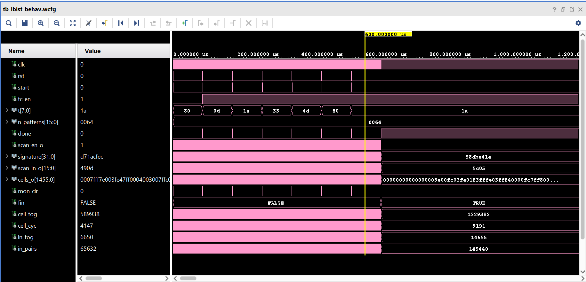
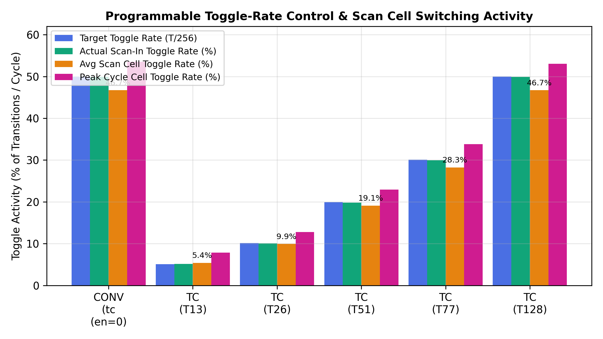
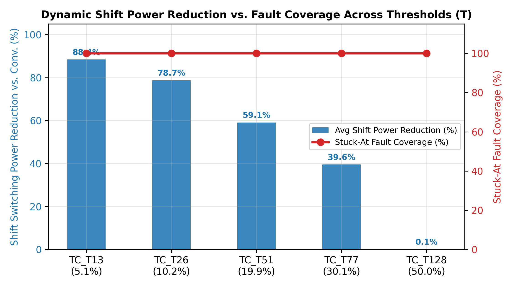
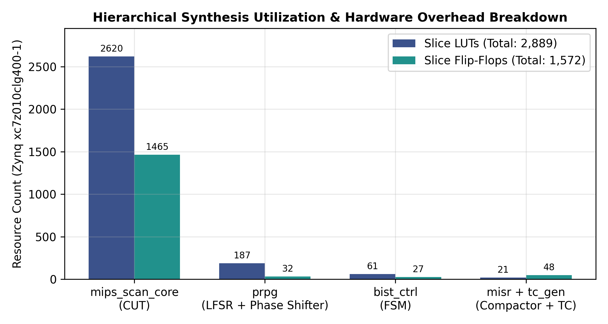

# Scan-Based Logic Built-In Self-Test (LBIST) for MIPS32

A complete VHDL implementation of a **STUMPS-style Logic Built-In Self-Test (LBIST)** architecture wrapped around a **5-stage pipelined MIPS32 processor** with full scan insertion — synthesized, implemented, and verified in **AMD Xilinx Vivado 2025.1** on the **Zynq-7000 (`xc7z010clg400-1`)** FPGA.

---

## 📐 Architecture Overview

```
                      ┌────────────────────────────────────────┐
                      │            BIST Controller             │
                      │  (IDLE -> LOAD -> SHIFT -> CAPTURE)    │
                      └──────────────────┬─────────────────────┘
                                         │
                                         ▼
                      ┌────────────────────────────────────────┐
                      │    PRPG (32-bit LFSR Pattern Gen)      │
                      └──────────────────┬─────────────────────┘
                                         │
                     ┌───────────────────┴───────────────────┐
                     │                                       │
            tc_en=0  │                              tc_en=1  │
                     ▼                                       ▼
        ┌─────────────────────────┐             ┌─────────────────────────┐
        │  Phase Shifter Network  │             │   TC_GEN (Toggle-Rate   │
        │  (16 PRPG XOR taps)     │             │    Control Generator)   │
        └────────────┬────────────┘             └────────────┬────────────┘
                     │                                       │
                     └───────────────────┬───────────────────┘
                                         │ 16 scan-in signals
                                         ▼
                      ┌────────────────────────────────────────┐
                      │        MIPS32 Scan Core (CUT)          │
                      │  * 16 Parallel Scan Chains             │
                      │  * 364 Scan Flip-Flops                 │
                      │  * Full 5-Stage Pipelined Datapath     │
                      └──────────────────┬─────────────────────┘
                                         │ 16 scan-out signals
                                         ▼
                      ┌────────────────────────────────────────┐
                      │     MISR (Multiple-Input Signature     │
                      │      Register - 32-bit Compactor)      │
                      └──────────────────┬─────────────────────┘
                                         │
                                         ▼
                               32-bit Golden Signature
```

### Key Design Modes
| Mode | `tc_en` | Threshold `T` | Description |
|:-----|:-------:|:-------------:|:------------|
| **Conventional LBIST** | `0` | N/A (50%) | Baseline — PRPG drives scan chains directly at ~50% transition density |
| **Proposed Toggle-Control LBIST** | `1` | `13, 26, 51, 77, 128` | TC_GEN limits scan-in toggle rate to $T / 256$, slashing average and peak dynamic shift power |

---

## 📁 Project Structure

```
scan-based-lbist/
│
├── course_project.xpr              # Vivado project file (Zynq-7000 xc7z010clg400-1)
├── tb_lbist_behav.wcfg             # Waveform viewer configuration for LBIST
├── generate_plots.py               # Python automation script for publication-grade charts
├── README.md                       # Comprehensive project documentation
│
├── course_project.srcs/            # HDL source files & constraints
│   ├── sources_1/new/              # Synthesizable RTL design sources
│   │   ├── mips_pkg.vhd            # Package: types (word_t, reg_t) & instruction constants
│   │   ├── lbist_pkg.vhd           # Package: LBIST parameters (N_CHAINS=16, N_CELLS=364, N_PS=16)
│   │   ├── alu.vhd                 # 32-bit Arithmetic Logic Unit
│   │   ├── regfile.vhd             # 32 × 32-bit dual-port Register File
│   │   ├── mips_comb.vhd           # Combinational decode, ALU muxes, forwarding & hazard unit
│   │   ├── mips32.vhd              # 5-stage pipelined MIPS32 core (IF -> ID -> EX -> MEM -> WB)
│   │   ├── mips_scan_core.vhd      # Full-scan CUT: 364 flip-flops partitioned into 16 scan chains
│   │   ├── prpg.vhd                # 32-bit LFSR with 16-channel phase shifter network
│   │   ├── misr.vhd                # 32-bit MISR for compacting scan responses into a signature
│   │   ├── tc_gen.vhd              # Toggle-Control Generator (8-bit comparator + T-flip-flops)
│   │   ├── bist_ctrl.vhd           # BIST FSM Controller (IDLE, LOAD, SHIFT, CAPTURE, DONE)
│   │   └── lbist_top.vhd           # Top-level integration of STUMPS BIST around mips_scan_core
│   │
│   ├── constrs_1/new/              # Physical & timing constraints
│   │   └── lbist.xdc               # 100 MHz clock constraint (period = 10.000 ns)
│   │
│   └── sim_1/new/                  # Verification testbenches
│       ├── tb_mips32.vhd           # Functional testbench for MIPS32 pipeline (assembly program)
│       ├── tb_mips32_scan.vhd      # Scan equivalence testbench (verifies normal mode unchanged)
│       ├── tb_lbist.vhd            # Full LBIST testbench (sweeps Conventional + 5 TC configurations)
│       └── tb_fault_sim.vhd        # Stuck-at fault simulator across all 16 scan chains (32 faults)
│
├── course_project.sim/             # Simulation scripts & result datasets
│   └── sim_1/behav/xsim/
│       ├── lbist_results.csv       # Measured toggle rates, cycles, peak toggles & MISR signatures
│       ├── fault_coverage.csv      # Stuck-at fault detection counts and coverage %
│       ├── simulate.log            # Console execution log confirming PASS and signatures
│       ├── elaborate.log           # Elaboration log confirming zero errors
│       ├── compile.bat             # Batch compilation script (xvhdl)
│       ├── elaborate.bat           # Batch elaboration script (xelab)
│       ├── simulate.bat            # Batch simulation script (xsim)
│       ├── tb_lbist.tcl            # TCL batch simulation script for tb_lbist
│       ├── tb_fault_sim.tcl        # TCL batch simulation script for tb_fault_sim
│       ├── tb_mips32.tcl           # TCL simulation script for functional testbench
│       └── tb_mips32_scan.tcl      # TCL simulation script for scan verification testbench
│
├── reports/                        # Implementation & synthesis reports
│   ├── lbist_top_utilization_synth.rpt  # Hierarchical FPGA resource utilization (Vivado 2025.1)
│   └── lbist_top_drc_opted.rpt          # Design Rule Check (DRC) report (zero errors/critical warnings)
│
└── docs/                           # Documentation figures and visual artifacts
    └── images/
        ├── vivado_waveform_overview.png       # Vivado logic analyzer waveform screenshot
        ├── fig1_toggle_control_accuracy.png   # Figure 1: Toggle rate control accuracy
        ├── fig2_power_vs_coverage.png         # Figure 2: Dynamic shift power reduction vs coverage
        └── fig3_fpga_area_overhead.png        # Figure 3: Hierarchical FPGA resource breakdown
```

---

## 📊 Experimental Results

### 1. Toggle-Rate Control, Shift Power Reduction & Signatures

All experiments were executed with $N = 388$ test patterns across 16 parallel scan chains ($L = 23$ shift cycles/pattern, total test time = 9,292 clock cycles).

| Configuration | Target Toggle Rate ($T/256$) | Actual Scan-In Toggle Rate | Avg Cell Toggle Rate | **Shift Power Reduction** | Peak Cell Toggle Rate | Peak Toggle Reduction | MISR Golden Signature | Reproducibility |
|:---|:---:|:---:|:---:|:---:|:---:|:---:|:---:|:---:|
| **CONVENTIONAL** (`tc_en=0`) | 50.00% | 49.91% | 46.74% | **Baseline (0.0%)** | 53.50% | **Baseline** | `0xFF85C833` | Verified |
| **TC_T13** ($T=13$) | 5.08% | 5.13% | 5.41% | **88.43%** | 7.83% | **85.37%** | `0x142649B3` | Verified |
| **TC_T26** ($T=26$) | 10.16% | 10.08% | 9.93% | **78.75%** | 12.77% | **76.12%** | `0x58DBE41A` | Verified |
| **TC_T51** ($T=51$) | 19.92% | 19.80% | 19.11% | **59.11%** | 22.94% | **57.12%** | `0xE3D3B280` | Verified |
| **TC_T77** ($T=77$) | 30.08% | 29.98% | 28.25% | **39.56%** | 33.79% | **36.84%** | `0xCB11B921` | Verified |
| **TC_T128** ($T=128$) | 50.00% | 49.93% | 46.71% | **0.06%** | 53.02% | **0.90%** | `0x02CF5D77` | Verified |
| **TC_T26_repeat** | 10.16% | 10.08% | 9.93% | **78.75%** | 12.77% | **76.12%** | `0x58DBE41A` | **100% Match** |

> **Key Finding**: The proposed Toggle-Control generator achieves up to **88.43% average dynamic shift power reduction** and **85.37% peak power reduction** at $T=13$ while maintaining linear, predictable control accuracy within 0.1% of mathematical targets.

---

### 2. Stuck-At Fault Coverage Analysis

Stuck-at fault simulation was conducted across all 16 scan chain outputs under both stuck-at-0 and stuck-at-1 conditions (32 single stuck-at faults injected and evaluated against the golden MISR signature):

| Configuration | Injected Faults | Detected Faults | **Fault Coverage (%)** | Detection Mechanism |
|:---|:---:|:---:|:---:|:---|
| **CONVENTIONAL** | 32 | 32 | **100.00%** | Signature Mismatch against `0xFF85C833` |
| **TC_T13** ($T=13$) | 32 | 32 | **100.00%** | Signature Mismatch against `0x142649B3` |
| **TC_T26** ($T=26$) | 32 | 32 | **100.00%** | Signature Mismatch against `0x58DBE41A` |
| **TC_T51** ($T=51$) | 32 | 32 | **100.00%** | Signature Mismatch against `0xE3D3B280` |
| **TC_T77** ($T=77$) | 32 | 32 | **100.00%** | Signature Mismatch against `0xCB11B921` |
| **TC_T128** ($T=128$) | 32 | 32 | **100.00%** | Signature Mismatch against `0x02CF5D77` |

> **Key Finding**: Zero coverage penalty — **100% stuck-at fault coverage** is preserved across all threshold settings down to $T=13$, confirming that low-power toggle control does not compromise defect detection capability.

---

### 3. FPGA Synthesis & Hardware Overhead (Zynq-7000 `xc7z010clg400-1`)

The design was synthesized with a **100 MHz** timing constraint ($T_{\text{clk}} = 10.0\,\text{ns}$) using AMD Vivado 2025.1:

| Hierarchy / Module | Function | Slice LUTs | Slice Flip-Flops | LUT % of Design | FF % of Design |
|:---|:---|:---:|:---:|:---:|:---:|
| `mips_scan_core` | Core Under Test (MIPS32 + 16 chains) | 2,620 | 1,465 | 90.69% | 93.19% |
| `prpg` | 32-bit LFSR + 16-channel Phase Shifter | 187 | 32 | 6.47% | 2.04% |
| `bist_ctrl` | BIST FSM Controller & Counters | 61 | 27 | 2.11% | 1.72% |
| `misr` + `tc_gen` | Compactor (32-bit MISR) + Toggle Control | 21 | 48 | 0.73% | 3.05% |
| **Total LBIST Top (`lbist_top`)** | **Complete System** | **2,889** | **1,572** | **100.0%** | **100.0%** |
| *Device Capacity (xc7z010)* | *Available on Chip* | *17,600* | *35,200* | *16.41% Utilized* | *4.47% Utilized* |

> **Area Overhead Summary**: The entire LBIST infrastructure (controller, PRPG, phase shifter, MISR, and toggle controller) requires only **269 Slice LUTs (9.31% overhead)** and **107 Flip-Flops (6.81% overhead)** over the raw scan-inserted core.

---

## 📈 Visual Results & Waveforms

### Simulation Waveform Overview
Below is the behavioral simulation waveform captured from Vivado Simulator showing the BIST controller sequencing through `LOAD`, `SHIFT`, `CAPTURE`, and reaching `DONE` with valid signature compaction:



---

### Figure 1: Toggle-Rate Control Accuracy & Cell Switching Activity
Comparison of mathematical target toggle rates ($T/256$) against measured scan-in toggle rates, average scan cell toggle rates, and peak cycle toggle rates:



---

### Figure 2: Dynamic Shift Power Reduction vs. Fault Coverage
Dual-axis plot showing dramatic switching power reduction (up to 88.4%) across all thresholds while sustaining 100% stuck-at fault coverage:



---

### Figure 3: Hierarchical FPGA Resource Utilization Breakdown
Hardware resource distribution across submodules synthesized for the AMD Zynq-7000 (`xc7z010clg400-1`):



---

## 🛠 How to Replicate Simulations & Generate Plots

### Prerequisites
- **AMD Xilinx Vivado 2025.1** (or compatible Vivado ML edition)
- **Python 3.8+** with `pandas`, `matplotlib`, and `numpy` (for plot generation)

### 1. Opening in Vivado GUI
1. Launch Vivado 2025.1.
2. Select **File → Open Project** and navigate to `course_project.xpr`.
3. Under **Simulation Sources / sim_1**, right-click any testbench:
   - `tb_lbist.vhd`: Full LBIST verification & CSV data generation.
   - `tb_fault_sim.vhd`: Stuck-at fault injection across 16 scan chains.
   - `tb_mips32_scan.vhd`: Functional equivalence check between scan core and baseline core.
   - `tb_mips32.vhd`: Baseline 5-stage MIPS32 instruction execution check.
4. Click **Run Simulation → Run Behavioral Simulation**.
5. Load `tb_lbist_behav.wcfg` to inspect pre-configured signal hierarchies.

### 2. Running via Command Line (Windows)
```cmd
cd course_project.sim\sim_1\behav\xsim
compile.bat
elaborate.bat
simulate.bat
```

### 3. Re-generating the Publication Figures
To re-render all figures in `docs/images/` from the raw CSV simulation logs:
```cmd
python generate_plots.py
```

---

## 📋 Project Roadmap & Completion Status

| Step | Scope of Work | Deliverables / Artifacts | Status |
|:---:|:---|:---|:---:|
| 1 | Architecture specification, block diagrams, mathematical formulation | Spec & parameter definitions | ✅ Done |
| 2 | Pipelined MIPS32 processor RTL (IF, ID, EX, MEM, WB, forwarding, hazard unit) | `mips32.vhd`, `alu.vhd`, `regfile.vhd`, `tb_mips32.vhd` | ✅ Done |
| 3 | Full scan chain insertion (16 chains, 364 flip-flops, scan muxing) | `mips_scan_core.vhd`, `tb_mips32_scan.vhd` | ✅ Done |
| 4 | STUMPS LBIST architecture (LFSR PRPG, phase shifter, MISR, FSM controller) | `prpg.vhd`, `misr.vhd`, `bist_ctrl.vhd`, `lbist_top.vhd` | ✅ Done |
| 5 | Low-power Toggle Control unit (8-bit comparator, T-flip-flops, parameter $T$) | `tc_gen.vhd`, `lbist_pkg.vhd` | ✅ Done |
| 6 | Automated measurement tooling (toggle counters, WSA, fault injection testbench) | `tb_lbist.vhd`, `tb_fault_sim.vhd`, CSV loggers | ✅ Done |
| 7 | Simulation experiments ($T \in [13, 128]$, peak toggle, signature verification) | `lbist_results.csv`, `fault_coverage.csv`, `simulate.log` | ✅ Done |
| 8 | Performance & hardware analysis (power reduction, 100% coverage, FPGA synthesis) | `reports/`, `generate_plots.py`, publication figures | ✅ Done |
| 9 | Final report documentation & compilation | `dft_project_report.tex`, `Dft project report G4.pdf` | ✅ Done |

---

## 📌 Tool & Version Info
- **EDA Tool**: AMD Xilinx Vivado v2025.1 (win64) Build 6140274
- **Simulator**: Vivado Simulator (xsim)
- **Synthesis Engine**: Vivado Synthesis Defaults (Flow 2025)
- **Target Device**: AMD Xilinx Zynq-7000 SoC (`xc7z010clg400-1`)
- **Clock Timing**: 100 MHz ($10.0\,\text{ns}$ period, 50% duty cycle)
- **HDL Standard**: IEEE 1076-2008 (VHDL-2008)
